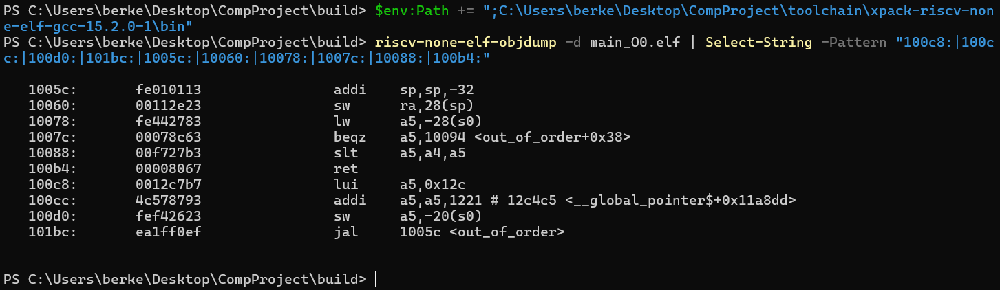
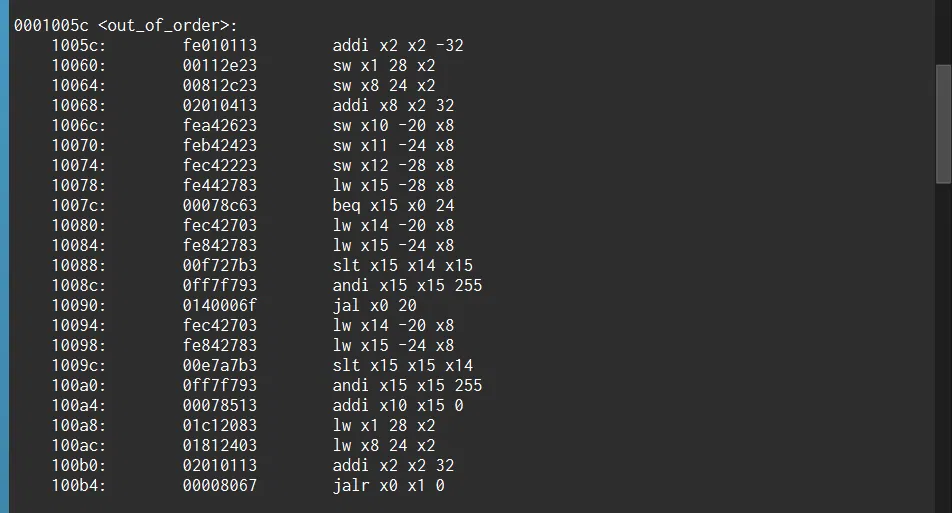
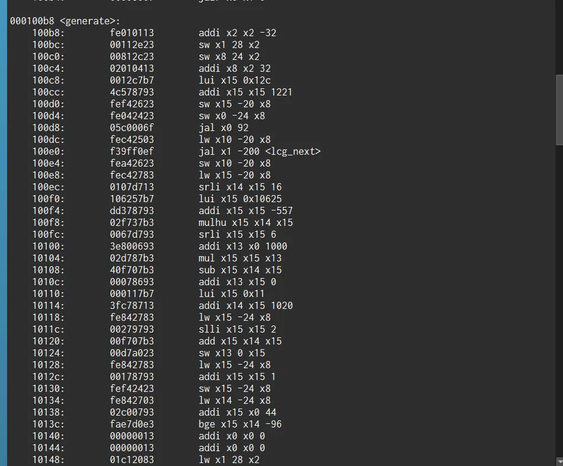
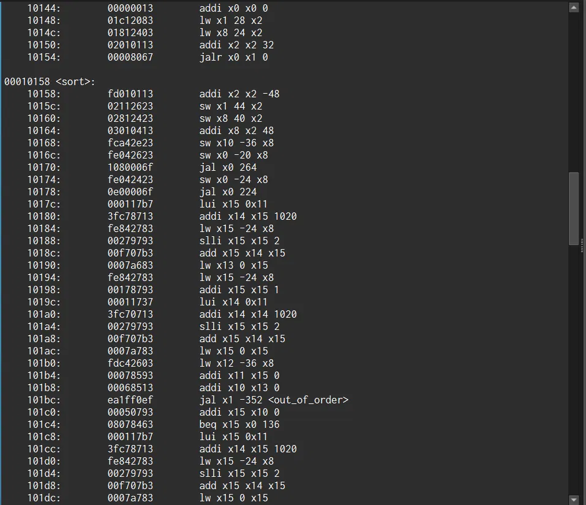
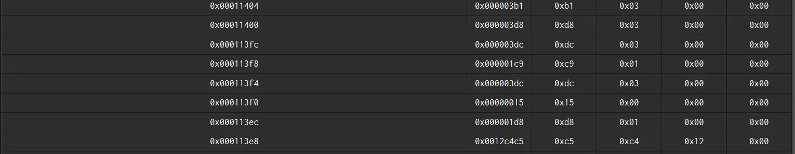

# M2 — Adım 2: Assembly ve machine code

*Tutanaktaki başlık: Adım 2 — Assembly ve machine code (M2: 9 Kasım, Pazartesi)*

## 2a. C → assembly eşlemesi (-O0; listenin tamamı depoda asm_O0.s)

| C satır no | C ifadesi | Assembly satırları | Adres aralığı (hex) |
|---|---|---|---|
| 22 | unsigned int x = (unsigned int)SID; | lui a5,0x12c addi a5,a5,1221 sw a5,-20(s0) | 0x000100C8 – 0x000100D0 |
| 10 (lcg_next) | return 1664525u * x + 1013904223u; | lw a4,-20(s0) lui a5,0x196 addi a5,a5,1549 mul a4,a4,a5 lui a5,0x3c6ef addi a5,a5,863 add a5,a4,a5 | 0x0001002C – 0x00010044 |
| 15–17 (out_of_order) | if (desc) return a &lt; b; return a &gt; b; | lw a5,-28(s0) beqz a5,.L4 lw a4,-20(s0) ; lw a5,-24(s0) slt a5,a4,a5 ; zext.b a5,a5 j .L5 (.L4:) lw a4,-20(s0) ; lw a5,-24(s0) slt a5,a5,a4 ; zext.b a5,a5 | 0x00010078 – 0x000100A0 |
| 33 | if (out_of_order(data[j], data[j + 1], desc)) | lui a5,0x11 ; addi a4,a5,1020 (&amp;data) lw a5,-24(s0) ; slli a5,a5,2 ; add a5,a4,a5 lw a3,0(a5)  (data[j]) … aynı dizilim, j+1 için …  lw a5,0(a5) lw a2,-36(s0) ; mv a1,a5 ; mv a0,a3 jal ra,out_of_order mv a5,a0 ; beqz a5,&lt;takas yok&gt; | 0x0001017C – 0x000101C4 |
| 34–37 | int t = data[j]; data[j] = data[j + 1]; data[j + 1] = t; swaps++; | t = data[j]: lw ... sw a5,-28(s0) data[j] = data[j+1]: lw a4,0(a5) ... sw a4,0(a5) data[j+1] = t: lw a4,-28(s0) ... sw a4,0(a5) swaps++: lui a5,0x11 ; lw a5,1016(a5) ; addi a4,a5,1 ; lui a5,0x11 ; sw a4,1016(a5)  (swaps = 0x113F8) | 0x000101C8 – 0x00010248 |
| 56 | sort(SID &amp; 1); | lui a5,0x12c addi a5,a5,1221 andi a5,a5,1 mv a0,a5 jal ra,sort | 0x000103B8 – 0x000103C8 |

| Bölüm | Başlangıç adresi (hex) | Boyut (byte) | İçerik |
|---|---|---|---|
| .text | 0x00010000 | 1000 (0x3E8) | Makine kodu: _start 0x00010000 (24 B), lcg_next 0x00010018, out_of_order 0x0001005C, generate 0x000100B8, sort 0x00010158, stats 0x0001029C, main 0x000103A4; son instruction 0x000103E4. |
| .data / .bss | 0x000113E8 | 200 (0xC8) | Aralık 0x000113E8 – 0x000114AF. .sdata (4 B): SID @ 0x113E8. .sbss (16 B): median 0x113EC, min_v 0x113F0, max_v 0x113F4, swaps 0x113F8. .bss (180 B): data[45] @ 0x113FC. |

## Von Neumann ilkesi bu adreslerde nasıl görünüyor? (1–2 cümle)

Instruction'lar (0x00010000–0x000103E7) ve veri (SID, sonuç değişkenleri, data[]: 0x000113E8–0x000114AF) aynı tek bellekte ve aynı adres uzayında bulunur; ikisi de aynı bit dizisi gösterimiyle saklanır ve aynı bus üzerinden erişilir (örn. 0x10078'deki lw instruction'ı da 0x113FC'deki data[0] da bir 32-bit word'dür). Hangisinin kod, hangisinin veri olduğunu bellek değil kullanım belirler: PC'nin gösterdiği word fetch edilip decode edilir, lw/sw'nin adreslediği word ise veri olarak okunur/yazılır.

## 2b. -O0 ve -O1 karşılaştırması (kernel için)

| Ölçü | -O0 | -O1 | Farkın nedeni |
|---|---|---|---|
| Kernel'deki instruction sayısı | 38 | 4 | Pencere (iki derlemede aynı C işi: satır 33'te operandların yüklenmesinden takas kararındaki branch'e kadar; pass = 0, j = 0, desc = 1). -O0: 16 (adres hesabı ve argüman hazırlığı) + 20 (jal → ret; M1 kernel'i) + 2 (mv, beqz) = 38. -O1: out_of_order inline edildi; kalan lw a4,0(a5) @0x100D4, lw a3,4(a5) @0x100D8, bnez a0 @0x100DC, blt a4,a3 @0x100C4. Call/return ve stack frame (prologue + epilogue = 10 instruction) ortadan kalktı. |
| Load sayısı | 10 | 2 | -O0: j her kullanımda stack'ten yeniden okunur ve data[] adresi her erişimde yeniden hesaplanır (5 load), ayrıca callee argümanları ve ra/s0'ı stack'ten geri yükler (5 load). -O1: a5 = &amp;data[j] register'da tutulur; yalnız iki operand load'u kalır. |
| Store sayısı | 5 | 0 | -O0: callee ra, s0, a0, a1, a2'yi stack'e kaydeder (5 sw). -O1: spill yok; takastaki iki sw (0x100E4, 0x100E8) karar penceresinin dışındadır. |
| Kullanılan register sayısı | 9 | 4 | -O0: sp, ra, s0 (frame pointer) ve a0–a5 arasından a0, a1, a2, a3, a4, a5. -O1: a0 (desc), a3, a4, a5 (&amp;data[j]); değişkenler register'da kaldığı için frame register'ları gerekmez. x0 sayılmadı. |

## 2c. Elle machine code (en az 10 instruction; x86-64 için 8)

Kullanılan tüm formatlar kapsanmalı.

| # | Adres (hex) | Assembly | Format | Alanlar (ad = binary) | Machine code (hex) | Bellekteki byte sırası | objdump ile aynı mı? |
|---|---|---|---|---|---|---|---|
| 1 | 0x000100C8 | lui a5,0x12c | U | imm[31:12]= 00000000000100101100 rd=01111 (a5) opcode=0110111 | 0x0012C7B7 | adres artar → B7 C7 12 00 | Evet |
| 2 | 0x000100CC | addi a5,a5,1221 | I | imm[11:0]=010011000101 rs1=01111 (a5) funct3=000 rd=01111 (a5) opcode=0010011 | 0x4C578793 | adres artar → 93 87 57 4C | Evet |
| 3 | 0x000100D0 | sw a5,-20(s0) | S | imm[11:5]=1111111 rs2=01111 (a5) rs1=01000 (s0) funct3=010 imm[4:0]=01100 opcode=0100011 | 0xFEF42623 | adres artar → 23 26 F4 FE | Evet |
| 4 | 0x000101BC | jal ra,out_of_order | J | imm[20]=1 imm[10:1]=1101010000 imm[11]=1 imm[19:12]=11111111 rd=00001 (ra) opcode=1101111 (offset = −352) | 0xEA1FF0EF | adres artar → EF F0 1F EA | Evet |
| 5 | 0x0001005C | addi sp,sp,-32 | I | imm[11:0]=111111100000 rs1=00010 (sp) funct3=000 rd=00010 (sp) opcode=0010011 | 0xFE010113 | adres artar → 13 01 01 FE | Evet |
| 6 | 0x00010060 | sw ra,28(sp) | S | imm[11:5]=0000000 rs2=00001 (ra) rs1=00010 (sp) funct3=010 imm[4:0]=11100 opcode=0100011 | 0x00112E23 | adres artar → 23 2E 11 00 | Evet |
| 7 | 0x00010078 | lw a5,-28(s0) | I | imm[11:0]=111111100100 rs1=01000 (s0) funct3=010 rd=01111 (a5) opcode=0000011 | 0xFE442783 | adres artar → 83 27 44 FE | Evet |
| 8 | 0x0001007C | beqz a5,.L4 (= beq a5,x0,+24) | B | imm[12]=0 imm[10:5]=000000 rs2=00000 (x0) rs1=01111 (a5) funct3=000 imm[4:1]=1100 imm[11]=0 opcode=1100011 | 0x00078C63 | adres artar → 63 8C 07 00 | Evet |
| 9 | 0x00010088 | slt a5,a4,a5 | R | funct7=0000000 rs2=01111 (a5) rs1=01110 (a4) funct3=010 rd=01111 (a5) opcode=0110011 | 0x00F727B3 | adres artar → B3 27 F7 00 | Evet |
| 10 | 0x000100B4 | ret (= jalr x0,0(ra)) | I | imm[11:0]=000000000000 rs1=00001 (ra) funct3=000 rd=00000 (x0) opcode=1100111 | 0x00008067 | adres artar → 67 80 00 00 | Evet |

## Zorunlu instruction'ların tablodaki sıra numarası

- ☒ SID'i yükleyen instruction(lar): # 1 ve 2 (lui + addi)

- ☒ Koşullu branch: # 8 (beqz a5,.L4 = beq a5,x0)

- ☒ Load: # 7 (lw a5,-28(s0))

- ☒ Store: # 3 (sw a5,-20(s0)); ayrıca # 6 (sw ra,28(sp))

- ☒ Fonksiyon çağrısı: # 4 (jal ra,out_of_order); dönüş: # 10 (ret)

## SID'in yüklenmesi

Sabitin neden tek instruction'a sığmadığı, nasıl bölündüğü ve gerekiyorsa +1 düzeltmenin sign extension ile açıklaması:

SID = 1230021 = 0x0012C4C5 değeri 21 bitlik anlamlı sayıdır, ancak RISC-V'de her instruction 32 bit'tir ve opcode (7 bit) ile rd (5 bit) alanları da bu 32 bit'in içindedir; geriye immediate için en fazla 20 bit (lui) veya 12 bit işaretli (addi) kalır. Bu yüzden 32 bitlik bir sabit tek instruction'a sığmaz, iki parçaya bölünür:

lui a5,0x12c → üst 20 bit = 0x0012C (300); a5 = 0x0012C << 12 = 0x0012C000.   addi a5,a5,1221 → alt 12 bit = 0x4C5 (1221); a5 = 0x0012C000 + 0x4C5 = 0x0012C4C5 = 1230021 ✓ (0x100C8 ve 0x100CC).

Sign extension ve +1 düzeltmesi: addi'nin 12 bitlik immediate'i işaretli genişletilir; alt 12 bit'in bit 11'i 1 ise sayı negatif sayılır ve toplamdan 0x1000 eksilir, bu yüzden lui'ye +1 eklenir (lui = (değer + 0x800) >> 12). SID'in alt 12 biti 0x4C5 = 0100 1100 0101 olup bit 11 = 0'dır; immediate pozitif kalır ve düzeltme gerekmez: (1230021 + 2048) >> 12 = 300 = 0x12C. Düzeltmenin gerektiği örnek aynı fonksiyondadır: % 1000 için kullanılan 0x10624DD3 sabitinin alt 12 biti 0xDD3'tür (bit 11 = 1, sign-extend ile −557), bu yüzden derleyici lui a5,0x10625 + addi a5,a5,-557 üretir (0x10625000 − 0x22D = 0x10624DD3; 0x100F0 ve 0x100F4). Not: SID const olduğundan -O0 derleyici değeri bellekten okumaz, lui/addi ile doğrudan immediate olarak yükler (generate 0x100C8 ve main 0x103B8).

## Branch offset hesabı. Branch'in adresi, hedef adres ve offset'in adım adım hesabı

Branch: beqz a5,.L4 (gerçek instruction: beq a5,x0,.L4), adresi 0x0001007C. Hedef (.L4, desc = 0 yolunun ilk instruction'ı lw a4,-20(s0)): 0x00010094.

## Ekran görüntüleri (hepsi Git deposunda screenshots/ klasöründedir)

*Görüntü 1 — objdump -d main_O0.elf çıktısı: 2c tablosundaki 10 instruction'ın hex kodları (ea1ff0ef, 0012c7b7, 4c578793, fef42623, fe010113, 00112e23, fe442783, 00078c63, 00f727b3, 00008067). Dosya: screenshots/m2_objdump_O0.png*

*Görüntü 2 — Ripes, out_of_order (0x1005C–0x100B4): tablodaki #5 (addi sp,sp,-32), #6 (sw ra,28(sp)), #7 (lw a5,-28(s0)), #8 (beq x15 x0 24) ve #10 (jalr x0 x1 0) burada görülüyor. Dosya: screenshots/m2_ripes_out_of_order.png*

*Görüntü 3 — Ripes, generate: SID'in yüklenmesi (#1 lui x15 0x12c @0x100C8, #2 addi x15 x15 1221 @0x100CC, #3 sw x15 -20 x8 @0x100D0) ve +1 düzeltmesinin gerektiği 0x10625 / -557 çifti (0x100F0–0x100F4). Dosya: screenshots/m2_ripes_generate.png*

*Görüntü 4 — Ripes, sort: kernel'in başladığı #4 jal x1 -352 <out_of_order> (0x101BC) ve dönüşteki beq x15 x0 136 (0x101C4). Dosya: screenshots/m2_ripes_sort_call.png*

*Görüntü 5 — Ripes bellek görünümü, 0x000113E8'den itibaren: SID 0x0012c4c5 (1230021), median 0x1d8 (472), min_v 0x15 (21), max_v 0x3dc (988), swaps 0x1c9 (457); byte sütunları little-endian sırayı gösteriyor. Dosya: screenshots/m2_outputs.png*

Offset = hedef − branch adresi = 0x10094 − 0x1007C = 0x18 = 24 byte (6 instruction ileri). Offset PC'ye göredir ve branch'in kendi adresinden ölçülür. B-formatı offset'in bit 0'ını saklamaz (instruction'lar 2 byte hizalı), bu yüzden imm = 24 = 0b0 0000 0001 1000 (13 bit, imm[12:0]) alanlara şöyle dağılır: imm[12] = 0 (bit 31), imm[10:5] = 000000 (bit 30:25), imm[4:1] = 1100 (bit 11:8), imm[11] = 0 (bit 7).

Alanlar: 0 | 000000 | rs2 = 00000 | rs1 = 01111 (a5) | funct3 = 000 (beq) | 1100 | 0 | 1100011 → 0000 0000 0000 0111 1000 1100 0110 0011 = 0x00078C63 (objdump ile aynı). Çalışma: kernel'de desc = 1 olduğundan a5 ≠ 0, branch alınmaz ve PC = 0x1007C + 4 = 0x10080 olur; desc = 0 olsaydı PC = 0x1007C + 24 = 0x10094 olurdu. Aynı yöntemle jal ra,out_of_order için offset = 0x1005C − 0x101BC = −352 (0xFFFFFEA0, 21 bit imm).
