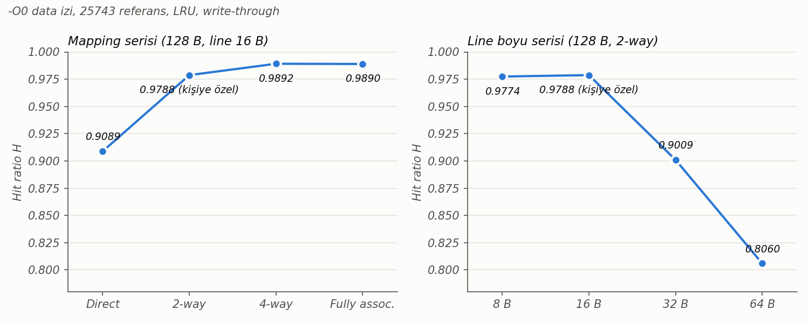

# M4 — Adım 4 ve Adım 5: Cache ve performans

*Tutanaktaki başlık: Adım 4 — Cache simülasyonu (final paketiyle: 16 Kasım, Pazartesi)*

## 4a. Data adres izi

Tüm load ve store'lar depoda trace.csv dosyasındadır. Biçim: sira,RW,adres_hex,boyut,c_satiri,stack_mi.

| Ölçü | Değer |
|---|---|
| Kullanılan derleme (-O0 / -O1) | -O0 (build/main_O0.elf); iz: build/trace_O0.csv (tools/rvsim.py ile üretildi) |
| Toplam data referansı | 25 743 (instruction fetch'ler hariç; yalnızca data cache) |
| Load / store | 17 514 / 8 229 |
| Stack erişimi sayısı | 20 708 (%80.4; stack_mi = 1, adres ≥ 0x70000000: 0x7FFFFF90–0x7FFFFFEF) |
| Ana diziye erişim sayısı | 3 986 (3027 load, 959 store; data[] = 0x000113FC–0x000114AF). Kalan 1 049 diğer global erişimi: swaps 914, min_v 88, max_v 46, median 1. |

İz dosyası: build/trace_O0.csv (25 743 satır, biçim sira,RW,adres_hex,boyut,c_satiri,stack_mi). -O1 izi karşılaştırma için build/trace_O1.csv (2 993 referans, yalnız 2 stack erişimi). Alan ayrıştırması: word = adres & 0xF (4 bit), set = (adres >> 4) & 3 (2 bit), tag = adres >> 6 (26 bit).

## 4b. İlk 5 farklı adresin alanları

| Adres (hex) | Adres (binary) | Tag | Line / Set | Word |
|---|---|---|---|---|
| 0x7FFFFFEC | 01111111111111111111111111 \| 10 \| 1100 | 0x1FFFFFF | 2 (set, 10) | 12 (1100) |
| 0x7FFFFFE8 | 01111111111111111111111111 \| 10 \| 1000 | 0x1FFFFFF | 2 (set, 10) | 8 (1000) |
| 0x7FFFFFDC | 01111111111111111111111111 \| 01 \| 1100 | 0x1FFFFFF | 1 (set, 01) | 12 (1100) |
| 0x7FFFFFD8 | 01111111111111111111111111 \| 01 \| 1000 | 0x1FFFFFF | 1 (set, 01) | 8 (1000) |
| 0x7FFFFFCC | 01111111111111111111111111 \| 00 \| 1100 | 0x1FFFFFF | 0 (set, 00) | 12 (1100) |

## 4c. Elle simülasyon (ilk 30 referans)

| # | R/W | Adres (hex) | Tag | Line / Set | Word | Hit / Miss | Yerinden çıkan blok | Bu blok daha önce cache'te miydi? |
|---|---|---|---|---|---|---|---|---|
| 1 | W | 0x7FFFFFEC | 0x1FFFFFF | 2 | 12 | Miss | – (yok) | Hayır (ilk erişim, compulsory) |
| 2 | W | 0x7FFFFFE8 | 0x1FFFFFF | 2 | 8 | Hit | – (yok) | Evet (cache'te, hit) |
| 3 | W | 0x7FFFFFDC | 0x1FFFFFF | 1 | 12 | Miss | – (yok) | Hayır (ilk erişim, compulsory) |
| 4 | W | 0x7FFFFFD8 | 0x1FFFFFF | 1 | 8 | Hit | – (yok) | Evet (cache'te, hit) |
| 5 | W | 0x7FFFFFCC | 0x1FFFFFF | 0 | 12 | Miss | – (yok) | Hayır (ilk erişim, compulsory) |
| 6 | W | 0x7FFFFFC8 | 0x1FFFFFF | 0 | 8 | Hit | – (yok) | Evet (cache'te, hit) |
| 7 | R | 0x7FFFFFC8 | 0x1FFFFFF | 0 | 8 | Hit | – (yok) | Evet (cache'te, hit) |
| 8 | R | 0x7FFFFFCC | 0x1FFFFFF | 0 | 12 | Hit | – (yok) | Evet (cache'te, hit) |
| 9 | W | 0x7FFFFFBC | 0x1FFFFFE | 3 | 12 | Miss | – (yok) | Hayır (ilk erişim, compulsory) |
| 10 | W | 0x7FFFFFB8 | 0x1FFFFFE | 3 | 8 | Hit | – (yok) | Evet (cache'te, hit) |
| 11 | W | 0x7FFFFFAC | 0x1FFFFFE | 2 | 12 | Miss | – (yok) | Hayır (ilk erişim, compulsory) |
| 12 | R | 0x7FFFFFAC | 0x1FFFFFE | 2 | 12 | Hit | – (yok) | Evet (cache'te, hit) |
| 13 | R | 0x7FFFFFBC | 0x1FFFFFE | 3 | 12 | Hit | – (yok) | Evet (cache'te, hit) |
| 14 | R | 0x7FFFFFB8 | 0x1FFFFFE | 3 | 8 | Hit | – (yok) | Evet (cache'te, hit) |
| 15 | W | 0x7FFFFFCC | 0x1FFFFFF | 0 | 12 | Hit | – (yok) | Evet (cache'te, hit) |
| 16 | R | 0x7FFFFFCC | 0x1FFFFFF | 0 | 12 | Hit | – (yok) | Evet (cache'te, hit) |
| 17 | R | 0x7FFFFFC8 | 0x1FFFFFF | 0 | 8 | Hit | – (yok) | Evet (cache'te, hit) |
| 18 | W | 0x000113FC | 0x000044F | 3 | 12 | Miss | – (yok) | Hayır (ilk erişim, compulsory) |
| 19 | R | 0x7FFFFFC8 | 0x1FFFFFF | 0 | 8 | Hit | – (yok) | Evet (cache'te, hit) |
| 20 | W | 0x7FFFFFC8 | 0x1FFFFFF | 0 | 8 | Hit | – (yok) | Evet (cache'te, hit) |
| 21 | R | 0x7FFFFFC8 | 0x1FFFFFF | 0 | 8 | Hit | – (yok) | Evet (cache'te, hit) |
| 22 | R | 0x7FFFFFCC | 0x1FFFFFF | 0 | 12 | Hit | – (yok) | Evet (cache'te, hit) |
| 23 | W | 0x7FFFFFBC | 0x1FFFFFE | 3 | 12 | Hit | – (yok) | Evet (cache'te, hit) |
| 24 | W | 0x7FFFFFB8 | 0x1FFFFFE | 3 | 8 | Hit | – (yok) | Evet (cache'te, hit) |
| 25 | W | 0x7FFFFFAC | 0x1FFFFFE | 2 | 12 | Hit | – (yok) | Evet (cache'te, hit) |
| 26 | R | 0x7FFFFFAC | 0x1FFFFFE | 2 | 12 | Hit | – (yok) | Evet (cache'te, hit) |
| 27 | R | 0x7FFFFFBC | 0x1FFFFFE | 3 | 12 | Hit | – (yok) | Evet (cache'te, hit) |
| 28 | R | 0x7FFFFFB8 | 0x1FFFFFE | 3 | 8 | Hit | – (yok) | Evet (cache'te, hit) |
| 29 | W | 0x7FFFFFCC | 0x1FFFFFF | 0 | 12 | Hit | – (yok) | Evet (cache'te, hit) |
| 30 | R | 0x7FFFFFCC | 0x1FFFFFF | 0 | 12 | Hit | – (yok) | Evet (cache'te, hit) |

## Cache'in 30. referanstan sonraki anı. Line sayınız 8'den fazlaysa satır ekleyin.

| Line | Set | Valid | Tag (hex) | Dirty (write-back) | LRU sırası (associative) |
|---|---|---|---|---|---|
| 0 | 0 (way 0) | 1 | 0x1FFFFFF | – (write-through, dirty biti yok) | tek geçerli way (way 1 boş) |
| 1 | 0 (way 1) | 0 | – | – | – |
| 2 | 1 (way 0) | 1 | 0x1FFFFFF | – (write-through, dirty biti yok) | tek geçerli way (way 1 boş) |
| 3 | 1 (way 1) | 0 | – | – | – |
| 4 | 2 (way 0) | 1 | 0x1FFFFFF | – (write-through, dirty biti yok) | LRU (sıradaki kurban) |
| 5 | 2 (way 1) | 1 | 0x1FFFFFE | – (write-through, dirty biti yok) | MRU (en son kullanılan) |
| 6 | 3 (way 0) | 1 | 0x1FFFFFE | – (write-through, dirty biti yok) | MRU (en son kullanılan) |
| 7 | 3 (way 1) | 1 | 0x000044F | – (write-through, dirty biti yok) | LRU (sıradaki kurban) |

## 4d. Tam simülasyon sonuçları

| Ölçü | Elle (ilk 30) | Araç (ilk 30) | Araç (tüm iz) |
|---|---|---|---|
| Referans | 30 | 30 | 25 743 |
| Hit | 24 | 24 | 25 196 |
| Miss | 6 | 6 | 547 |
| Hit ratio H | 24 / 30 = 0.8000 | 24 / 30 = 0.8000 | 25 196 / 25 743 = 0.9788 |
| Ana belleğe yazma sayısı | 16 (write-through: her store = 1 bellek yazması) | 16 | 8 229 (= store sayısı); ayrıca 547 blok okuması |

## Kullanılan araç ve ayarları (kendi simülatörünüz varsa dosya adı)

Kendi simülatörüm tools/cachesim.py: python tools/cachesim.py build/trace_O0.csv --d 1 --show 30 --sweep → 128 B, 16 B line, 2-way set-associative (4 set), LRU, write-through + write-allocate (proje varsayımı), yalnızca data referansları. Write-through'da ana belleğe yazma sayısı store sayısına eşittir; dirty line yoktur, program sonunda cache'te dirty blok kalmaz.

- ☒ Elle ve araçla yapılan simülasyon ilk 30 referansta birebir örtüşüyor.

## 4e. Tasarım uzayı (cache boyu sabit)

| Mapping (line boyu sabit = 16 B) | Hit | Miss | H |
|---|---|---|---|
| Direct | 23 398 | 2 345 | 0.9089 |
| 2-way set-associative | 25 196 | 547 | 0.9788 |
| 4-way set-associative | 25 464 | 279 | 0.9892 |
| Fully associative (LRU) | 25 459 | 284 | 0.9890 |

| Line boyu (mapping sabit = 2-way set-assoc.) | Hit | Miss | H |
|---|---|---|---|
| 8 B | 25 162 | 581 | 0.9774 |
| 16 B | 25 196 | 547 | 0.9788 |
| 32 B | 23 193 | 2 550 | 0.9009 |
| 64 B | 20 748 | 4 995 | 0.8060 |

## Grafik dosyası ve eğilimlerin locality ile açıklaması (thrashing varsa çatışan adresler)

Grafik: screenshots/m4_design_space.png (tools/design_space.py ile üretildi, aşağıda). Mapping serisi: direct'ten 2-way'e H 0.9089 → 0.9788'e çıkar. Direct'te her set tek line'dır; sürekli kullanılan stack line'ları (sort frame 0x7FFFFFB0–0x7FFFFFCF, out_of_order frame 0x7FFFFF90–0x7FFFFFAF) ile dizi line'ları aynı line'a düştükçe birbirini atar (conflict miss, 2 345 miss). 4-way (279 miss) ve fully associative (284 miss) neredeyse eşittir: kalan miss'ler artık conflict değil capacity miss'idir; 180 byte'lık dizi 128 byte'lık cache'e sığmaz ve bubble sort her geçişte diziyi baştan taradığı için LRU, en eski dizi line'larını tekrar kullanılmadan atar (fully associative'in 4-way'den 5 miss kötü olması, LRU'nun sıralı taramalardaki bu davranışından gelir). Temporal locality'yi stack değişkenleri (j, pass, desc, argümanlar) sağlar; H'nin yüksek olması -O0 izinin %80'inin stack olmasındandır. Line boyu serisi: 8 B → 16 B'de H hafif artar (spatial locality: bir miss 2 yerine 4 int getirir). 32 B'de cache 4 line / 2 set'e, 64 B'de 2 line / 1 set'e düşer; line sayısı azaldığı için stack frame'leri ile dizi line'ları aynı set için yarışır ve H 0.9009'a, sonra 0.8060'a düşer. Büyük line, gelecekte kullanılmayacak byte'ları da getirip az sayıdaki line'ı işgal eder (pollution). Thrashing (kişiye özel 2-way): set 3'te üç sıcak blok iki way için yarışır: 0x7FFFFFB0 bloğu (sort'un her karşılaştırmada okunan desc argümanı, 0x7FFFFFBC), 0x000113F0 bloğu (swaps = 0x000113F8 ve data[0] = 0x000113FC) ve dizi blokları 0x00011430 / 0x00011470. Miss'lerin 151'i 0x7FFFFFB0, 147'si 0x000113F0, 34'ü 0x00011430 bloğundadır (toplam 547'nin %60'ı); her takasta swaps++ set 3'e erişip sort'un stack bloğunu atar.

*Görüntü 6 — 4e tasarım uzayı: mapping serisi (sol) ve line boyu serisi (sağ), -O0 izi, 128 B cache. Dosya: screenshots/m4_design_space.png*

## 4f. Ortalama erişim süresi

T_s = H × T1 + (1 − H) × (T1 + T2)

| Durum | H | T_s (cycle) | Speedup (cache'siz duruma göre) |
|---|---|---|---|
| Cache yok | 0 | T2 = 25 | 1 |
| Kişiye özel cache | 0.9788 (25 196 / 25 743) | 0.9788 × 1 + 0.0212 × (1 + 25) = 1.531 | 25 / 1.531 = 16.33 |

## 4g. Kod değişikliği

|   | Önce | Sonra |
|---|---|---|
| Değiştirilen C satır(lar)ı | main.c satır 37: swaps++; (global sayaç her takasta bellekte okunup yazılır) | main_v2.c satır 31: int s = 0; satır 38: s++; satır 40: swaps = s; (sayaç sort'un yerel değişkeni; global bir kez yazılır) |
| Y7 çıktısı (aynı olmalı) | median 472, min_v 21, max_v 988, swaps 457 | median 472, min_v 21, max_v 988, swaps 457 (aynı; tools/rvsim.py build/main_v2_O0.elf) |
| H | 0.9788 (25 196 / 25 743; 547 miss) | 0.9903 (25 497 / 25 746; 249 miss) |
| T_s (cycle) | 1.531 | 0.9903 × 1 + 0.0097 × 26 = 1.242 (speedup 1.23) |

## Değişikliğin gerekçesi; H artmadıysa nedeni

4e'deki thrashing'in nedeni, her takasta yapılan swaps++ erişiminin (0x000113F8) set 3'e düşmesi ve orada sort'un stack bloğu 0x7FFFFFB0 ile dizi bloklarıyla (0x00011430, 0x00011470) iki way için yarışmasıdır. Veri yerleşimi değişikliği: sayaç, sort'un zaten sürekli kullanılan stack frame'indeki yerel s değişkenine taşındı ve global swaps'a döngü bittikten sonra bir kez yazıldı. Böylece 0x000113F0 bloğu sıcak olmaktan çıktı; set 3'teki çatışma kalktı ve miss sayısı 547'den 249'a indi (kalan miss'ler dizinin cache'e sığmamasından gelen capacity miss'leridir; her dizi bloğu ~20–31 miss). Referans sayısı neredeyse aynıdır (25 743 → 25 746), Ic ise 64 567'den 63 656'ya düştü. Y7 değişmedi; yani değişiklik organizasyonel bir iyileştirmedir, programın sonucu aynıdır. Not: değişiklikle .text 4 byte uzadığı için global değişkenler 4 byte kaydı (swaps 0x000113FC); sonuç ve analiz build/main_v2_O0_symbols.txt adresleriyle yapılmıştır.

# Adım 5 — Performans ve architecture/organization (final paketiyle: 16 Kasım, Pazartesi)

## 5a-1. Dinamik instruction dağılımı ve CPI (CPI_i değerleri yönergedeki model varsayımıdır)

| Sınıf | CPI_i (varsayım) | I_i (-O0) | I_i (-O1) |
|---|---|---|---|
| ALU | 1 | 32 336 (%50.1) | 3 376 (%33.1) |
| Çarpma | 3 | 135 (%0.2) | 135 (%1.3) |
| Load | 1 | 17 514 (%27.1) | 2 028 (%19.9) |
| Store | 1 | 8 229 (%12.7) | 965 (%9.5) |
| Branch / jump | 2 | 6 353 (%9.8) | 3 705 (%36.3) |
| Ic (toplam) | – | 64 567 (Σ CPI_i × I_i = 71 190 cycle) | 10 209 (Σ CPI_i × I_i = 14 184 cycle) |
| Ortalama CPI | Σ(CPI_i × I_i) / Ic | 71 190 / 64 567 = 1.1026 | 14 184 / 10 209 = 1.3894 |

## 5a-2. Süre ve MIPS rate (f = 1.1 GHz (varsayım), τ = 1 / f = 0.9091 ns)

| Ölçü | Formül | -O0 | -O1 |
|---|---|---|---|
| T (bellek etkisi yok) | Ic × CPI × τ | 71 190 cycle × 0.9091 ns = 64.72 µs | 14 184 cycle × 0.9091 ns = 12.89 µs |
| MIPS rate | f / (CPI × 10⁶) | 1100 MHz / 1.1026 = 997.7 MIPS | 1100 MHz / 1.3894 = 791.7 MIPS |
| m (instruction başına data referansı) | data ref. / Ic | 25 743 / 64 567 = 0.3987 | 2 993 / 10 209 = 0.2932 |
| T, cache yok (k = T2) | Ic × [p + (m × k)] × τ | 64 567 × [1.1026 + 0.3987 × 25] = 714 765 cycle → 649.79 µs | 10 209 × [1.3894 + 0.2932 × 25] = 89 009 cycle → 80.92 µs |
| T, cache var (k = T_s) | Ic × [p + (m × k)] × τ | T_s = 1.5312 (H = 0.9788): 64 567 × [1.1026 + 0.3987 × 1.5312] = 110 608 cycle → 100.55 µs | T_s = 1.9522 (-O1 izi, H = 0.9619: 2879 hit / 114 miss): 10 209 × [1.3894 + 0.2932 × 1.9522] = 20 027 cycle → 18.21 µs |

Varsayımlar: CPI_i, f, T1 = 1 cycle ve T2 = 25 cycle model parametresidir, ölçüm değildir. Instruction fetch'lerin 1 cycle'da karşılandığı varsayılır (p'nin içindedir); yalnız data referansları k ile maliyetlendirilir. p = ortalama CPI. Ic, tools/rvsim.py'nin yürüttüğü instruction sayısıdır (sondaki ecall hariç; Ripes 64 568 sayar = 64 567 + ecall). Cache var / cache yok oranı: -O0 6.46, -O1 4.44.

| Karşılaştırma | Değer |
|---|---|
| Speedup -O0 → -O1 (Eq. 2.1, cache var) | T(-O0) / T(-O1) = 110 608 / 20 027 = 5.52 (bellek etkisi olmadan 71190 / 14184 = 5.02) |
| Speedup cache yok → cache var (-O0) | 714 765 / 110 608 = 6.46 |

## MIPS rate'in iki derlemeyi karşılaştırmada neden yanıltıcı olabileceği, kendi sayılarınızla

-O0'ın MIPS rate'i (997.7) -O1'inkinden (791.7) yüksektir; bu, -O0'ın daha hızlı olduğu izlenimini verir. Oysa -O0 64 567 instruction yürütür, -O1 yalnız 10 209; aynı işi -O1 5.02 kat (bellek etkisiyle 5.52 kat) daha kısa sürede yapar. -O0'ın fazladan instruction'ları çoğunlukla CPI'si 1 olan load/store'lardır (Ic'nin %39.9'u; bu data referanslarının %80'i stack'tir); bunlar ortalama CPI'yi düşürüp MIPS'i şişirir. -O1'de kalan instruction'ların büyük kısmı branch/jump'tır (%36.3, CPI 2), bu yüzden CPI yükselir ve MIPS düşer. MIPS, instruction başına işi sabit kabul eder; farklı derlemelerde (ve farklı ISA'larda) instruction sayısı değiştiği için yalnız yürütme süresi (Eq. 2.1) doğru karşılaştırmadır. Ayrıca MIPS bellek etkisini (m × k) hiç görmez.

## 5a-3. Amdahl yasası (Nc = 2 (varsayım))

| Alan | Değer |
|---|---|
| Paralelleştirilebilen kısım (C satırları) | stats() döngüsü, satır 44–49 (min_v/max_v taraması). Diğer kısımlar sıralı kabul edildi. |
| Bağımsızlık gerekçesi (veri bağımlılığı) | stats()'ta her i iterasyonu yalnız data[i]'yi okur ve diziye yazmaz; min ve max birleşmeli (associative) indirgemelerdir. Dizi iki yarıya bölünür (i = 1–22 ve 23–44), her çekirdek kendi yerel min/max'ını bulur, sonuçlar sonda tek karşılaştırmayla birleştirilir. Paralelleştirilemeyenler: generate()'te x_{i+1} = LCG(x_i) zinciri her iterasyonu bir öncekine bağlar; bubble sort'ta j iterasyonu, j − 1'deki takasın yazdığı data[j]'yi okur (read-after-write) ve her geçiş öncekinin sonucuna bağlıdır. Sıralamayı paralelleştirmek algoritmayı değiştirmeyi gerektirir (ör. odd-even transposition sort); bu yapılmadı. |
| f (yürütme süresindeki pay) | f = T(satır 44–49) / T = 2347 / 110608 cycle = 0.0212 (%2.12); -O0, cache var modeli (her instruction CPI_i + data referansı başına T_s = 1.5312), build/exec_O0.csv'deki C satırı sütunundan. |
| Speedup = 1 / [(1 − f) + f / Nc] | 1 / [(1 − 0.0212) + 0.0212 / 2] = 1 / 0.9894 = 1.0107 |
| Nc → ∞ limiti | 1 / (1 − f) = 1 / 0.9788 = 1.0217. Sıralama zamanın %97.9'ini aldığı için çekirdek sayısı arttırılsa da program en fazla ~%2 hızlanır; asıl kazanç algoritma (O(N²)) ve derleme (-O1) değişikliğindedir. |

## 5b. Architecture ve organization (en az 10 özellik)

| # | Özellik | Architecture / Organization | Gerekçe (Stallings tanımı) | Değişseydi Y7 değişir miydi? Kanıt |
|---|---|---|---|---|
| 1 | Instruction formatı (RV32: 32-bit sabit, R/I/S/B/U/J) | Architecture | Programcıya/derleyiciye görünür; machine code'un anlamını belirler (2c'de elle kodlandı). | Hayır, program yeniden derlenirse; ama mevcut makine kodu (ör. 0x0012C7B7) başka formatta çalışmaz. Kanıt: aynı C kodu iki farklı kodlamayla (-O0/-O1) aynı Y7'yi verir: median 472, min_v 21, max_v 988, swaps 457. |
| 2 | Register sayısı (32 × 32-bit x register) | Architecture | Instruction'daki 5-bit rs/rd alanları ve ABI (a0–a7, sp, ra) buna bağlıdır; programcı görür. | Hayır (yeniden derlenirse); daha az register'da derleyici daha çok spill yapar, yalnız Ic ve m değişir (2b: -O0 9, -O1 4 register). |
| 3 | Adresleme modları (base + 12-bit offset, PC-relative branch/jal) | Architecture | Instruction setinin parçasıdır; lw x15,-28(x8) ve beq offset'i (+24) buna göre yazılır. | Hayır (yeniden derlenirse); adres hesabı için gereken instruction sayısı değişir. |
| 4 | Interrupt/trap mekanizması (mepc, mcause, mtvec, mret) | Architecture | Privileged ISA'da tanımlıdır; handler yazan programcı (OS) görür ve kullanır. | Hayır: 3c'de interrupt user program için şeffaftır; dönüşte aynı state'ten devam edilir, Y7 aynı kalır, yalnız süre uzar. |
| 5 | Veri türü genişliği (int / unsigned int = 32 bit, mod 2³² taşma) | Architecture | Programcının gördüğü veri temsilidir; LCG'nin mod 2³² davranışı buna dayanır. | Evet: LCG mod 2⁶⁴ hesaplasaydı x dizisi, dolayısıyla data[] ve Y7 değişirdi: median 339, min_v 15, max_v 994, swaps 530 (tools/reference.py'deki &amp; 0xFFFFFFFF maskesi 64 bite çevrilerek hesaplandı). Tablodaki özelliklerden Y7'yi değiştiren tek özellik budur. |
| 6 | Çarpma instruction'ının varlığı (M uzantısı: mul, mulhu) | Architecture | Instruction setinde olup olmadığı programcıya görünür (-march=rv32im). | Hayır: rv32i'de çarpma __mulsi3 kütüphane çağrısı olurdu (yönergede yasak), sonuç aynı; Ic ve süre artardı. |
| 7 | Cache boyu ve mapping (128 B, 2-way, LRU) | Organization | Programcıya görünmez; ISA aynı kalır, yalnız erişim süresi değişir. | Hayır: cache yalnız verinin kopyasını tutar, write-through/write-allocate değerleri değiştirmez; 4e'deki her konfigürasyonda aynı iz ve aynı Y7. Süre değişir: direct T_s = 3.277 → T = 141.4 µs; 2-way 1.531 → 100.6 µs; fully assoc. 1.276 → 94.6 µs (-O0). |
| 8 | Line boyu (16 B) | Organization | Bellek ile cache arasındaki transfer birimidir; programcı görmez. | Hayır: 64 B line'da H = 0.8060, T_s = 5.851, T = 201.6 µs (16 B'de 100.6 µs); Y7 aynı. |
| 9 | Write policy (write-through) | Organization | Belleğin ne zaman güncellendiğini belirleyen donanım kararıdır; programcıya görünmez. | Hayır: write-through 8 229, write-back 353 ana bellek yazması (aynı 2-way cache, tools/cachesim.py --policy wb); hit/miss sayısı (25196/547) ve Y7 aynı, yalnız bellek trafiği değişir. |
| 10 | Data bus genişliği (32 bit) | Organization | Bir bus cycle'da aktarılan bit sayısıdır; ISA aynıdır. | Hayır: 3d'de 16-bit bus'ta kernel 30 yerine 60 bus cycle ister; değerler aynı, süre artar. |
| 11 | MAR / MBR / IR (kavramsal register'lar) | Organization | ISA'da tanımlı değildir, programcı erişemez (3b IAS tablosu). | Hayır: datapath'in iç yapısıdır; değişmesi yalnız cycle sayısını etkiler. |
| 12 | Saat frekansı f (1.1 GHz, varsayım) | Organization | Donanım gerçeklemesinin özelliğidir; aynı ISA farklı frekanslarda çalışır. | Hayır: f iki katına çıksa τ yarıya iner, T(-O0, cache var) 100.55 → 50.28 µs olur; Y7 aynı. |

## Ch. 1.2'deki dört temel fonksiyon

| Fonksiyon | Kernel'den örnek instruction (adres, assembly) | Açıklama |
|---|---|---|
| Data processing | 0x00010088: slt x15, x14, x15 (kernel #13) | ALU iki operandı karşılaştırır (190 &lt; 378 → 1); veri üzerinde işlem. |
| Data storage | 0x00010060: sw x1, 28(x2) (kernel #3) | Dönüş adresi 0x101C0 bellekte (stack, 0x7FFFFFAC) saklanır; data[] ve sonuç global'leri de bellekte tutulur. |
| Data movement | 0x00010080: lw x14, -20(x8) (kernel #11) | Veri bellekten (0x7FFFFF9C) register'a taşınır; bus üzerinden processor–memory aktarımı. |
| Control | 0x0001007C: beq x15, x0, 0x10094 (kernel #10); ayrıca jal (#1), jalr (#20) | Akışı yönetir: koşula göre PC'yi değiştirir, fonksiyona girip çıkar. |
